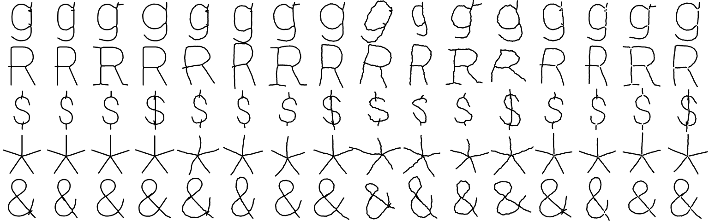

# Method

How [fonts.gnass.buzz](../README.md) finds fonts by drawn shape and by measured look, how well that works, and how it relates to earlier work. For commands and file formats, see [PIPELINE.md](PIPELINE.md).

## The problem

Google Fonts has about 1,900 families. Its own filters are hand-assigned categories ("Display", "Handwriting") and moods ("Playful"). They do not answer questions about letterforms: which fonts have a single-story g, an asterisk with four arms, an A with a very low crossbar?

The app offers two answers:

1. **Shape search.** Draw a character (or pick a font as an example) and get the fonts whose glyphs have a similar shape.
2. **Measured sliders.** Instead of categories, about 15 values measured from the outlines (weight, width, contrast, serifs, x-height, ornament, …), each a range slider with a histogram of all fonts.

[Shapecatcher](https://shapecatcher.com) (Milde, 2011) does the first for Unicode: draw a symbol, get the characters that look like it. The task here is different in one important way. Shapecatcher must find out *which* character was drawn, a classification over many classes. Here the character is known (the user draws a "g"), and the task is to rank about 1,700 glyphs of that one character by fine differences of form. In the terms of the sketch retrieval literature, this is *fine-grained, instance-level* retrieval (Yu et al., 2016) rather than category-level retrieval (Eitz et al., 2011).

## Shape search

### Representation: skeletons, not outlines

A sketch is a set of thin pen strokes. It has no stroke width, no contrast and no serifs. A glyph has all of these. To compare the two, every glyph is reduced to its **medial axis** (Blum, 1967): the center line of its strokes.

The medial axis is approximated from the Voronoi diagram of dense samples of the outline (Brandt & Algazi, 1992): Voronoi vertices inside the glyph lie close to the axis, and their circumradius is the local half stroke width. The raw axis has many short branches into corners. They are pruned with three heuristics:

- **Corner trimming.** Towards a corner of angle θ, the inscribed radius shrinks at a rate of sin(θ/2) per unit length. An end is trimmed while its radius changes faster than 0.35 per unit length (corners wider than about 40°). Pointed strokes and script tails taper more slowly and stay.
- **Short branches.** A terminal branch shorter than 0.9 times the half stroke width at its junction is removed.
- **End extension.** Each free end is carried on in a straight line to the outline, so that a stroke ends where the ink ends.

The thresholds are hand-tuned on contact sheets, not learned. Principled alternatives exist, for example the λ-medial axis (Chazal & Lieutier, 2005), the scale axis transform (Giesen et al., 2009) and discrete curve evolution (Bai et al., 2007). They were not compared.

Every skeleton is scaled to fit a 64 × 64 frame and stored as polylines (about 35 MB for 83 characters × 1,829 fonts). Pruning can remove a short but meaningful stem. For this reason, the stroke ends are also computed separately: the filled glyph is thinned on a raster (Zhang & Suen, 1984) without pruning.

### Matching a sketch

A sketch is normalized to the same frame, using its bounding box. For each candidate glyph:

- The **symmetric chamfer distance** (Barrow et al., 1977) between the two point sets on the 64 × 64 raster, with a 3-4 distance transform (Borgefors, 1986). It is the mean distance from each point of one set to the nearest point of the other, averaged over both directions.
- **Plus a stroke-end term:** the mean distance between the stroke ends of the sketch and the glyph, plus a penalty for each extra or missing end. Chamfer distance alone barely notices whether a stroke goes through or stops short. The number of ends is what separates, for example, a "$" with one stroke from one with two.

Fonts are ranked by this sum. The weights of the two terms are hand-tuned.

### Matching an example font

When the query is a glyph of another font, both sides have the same kind of skeleton, so a learned feature can be used. Each skeleton is drawn with a fixed stroke width and embedded with DINOv2 ViT-S/14 (Oquab et al., 2023). The features are the mean patch tokens on a 4 × 4 grid, reduced with PCA to 256 dimensions and quantized to int8. The fonts are ranked by cosine similarity. DINOv2 was not fine-tuned. It is a generic image feature, used here because a 4 × 4 grid of patch features keeps the spatial layout, which a single global vector loses.

### Several letters

A query can contain several letters, some drawn and some taken from an example font. For each letter, all fonts are ranked, and the ranks are scaled to 0–1. The final score is a weighted mean: drawn letters together count 80 % and example letters 20 %. Ranks, not distances, are averaged, because chamfer distances and cosine similarities are on different scales.

### What is left out of the search

Some fonts have no usable letterforms: barcodes, placeholder fonts (Redacted, Flow), knitting patterns, textures. Two measures exclude them without a list of names:

- **Distinctness:** the mean chamfer distance between the skeletons of 12 letters of the font, relative to the median font. A barcode font has nearly identical "letters".
- **Recognition:** for 12 letters, whether the nearest reference glyphs (from 300 popular fonts) in DINOv2 space are the same letter, after subtracting the font's mean feature (to remove its texture).

## Measured sliders

Every slider is a value measured from the outlines, with no category labels involved:

| Slider | Measurement |
|---|---|
| Weight | mean stroke width relative to cap height, per style |
| Width | mean letter width relative to cap height (capitals) and x-height (lowercase); along the wdth axis for variable fonts |
| Slant | angle of vertical strokes, per style |
| Serifs | how far feet and heads of I, H, n reach beyond their stems |
| Serif type | serif thickness relative to stem width (hairline to slab) |
| Contrast | thick divided by thin stroke parts |
| Ends | share of square or pointed stroke ends in a–z |
| Straightness | share of straight outline segments |
| Ornate | ink beyond the letter's box (left of the origin, right of the advance, below the baseline), in x-heights |
| Connected | share of 12 letter pairs whose ink touches when shaped |
| Stroke fill | gaps between paired ink edges in horizontal sections (outline vs. solid strokes) |
| x-height | x-height relative to cap height |
| Circular o | variation of the outline's distance from the center of o and O |
| Aperture | opening angle of c and e |
| Width variation | standard deviation of the advance widths of a–z divided by their mean |

All of these are heuristics with known failure cases. The next section checks them against human judgments.

**Look-alike groups.** For browsing, the fonts are clustered into 80 groups with spherical k-means (Dhillon & Modha, 2001) on a "style" vector: DINOv2 features of a two-line specimen ("RAGE / hang"), reduced to 128 dimensions. The app shows one font per group.

**"What should change?"** When the user rejects a font, the app suggests up to three slider changes that would exclude it and keep many other fonts. This is a form of relative attribute feedback, as in WhittleSearch (Kovashka et al., 2012). Here the attributes are measured, not learned.

## Evaluation

There are two questions: do the slider values agree with what people see, and does the shape search find the forms a user draws? Both tests run without new human input. The scripts are in [`eval/`](../eval) and the results in [`eval/results/`](../eval/results).

### Sliders against crowdsourced judgments

O'Donovan et al. (2014) collected human judgments for 37 attributes of 200 fonts. For 31 relative attributes ("thin", "wide", …), crowd workers compared pairs of fonts (800 pairs per attribute, 8 workers per pair), and a Bradley–Terry model turned the comparisons into scores. Six binary attributes ("serif", "italic", "monospace", …) were labeled by the authors. 179 of the 200 fonts are still on Google Fonts (some under a new name). The other 21 are commercial fonts or were removed. Where a font in their set is a specific style (Lato Black Italic), the weight and slant of that style are used.

Spearman correlation with a 95 % interval (Fisher z), n ≈ 179 (`uv run eval/attributes.py`):

| Slider | Attribute | ρ | 95 % CI |
|---|---|---|---|
| Weight | thin | −0.90 | [−0.93, −0.85] |
| Weight | strong | +0.88 | [+0.83, +0.91] |
| Slant | italic | +0.76 | [+0.68, +0.83] |
| Serifs | serif | +0.74 | [+0.65, +0.81] |
| Ornate | artistic | +0.49 | [+0.36, +0.60] |
| Ornate | graceful | +0.46 | [+0.33, +0.57] |
| Width variation | monospace | −0.38 | [−0.50, −0.24] |
| Connected | cursive | +0.37 | [+0.23, +0.49] |
| Width | wide | +0.34 | [+0.20, +0.47] |
| Contrast | delicate | +0.22 | [+0.07, +0.35] |
| Contrast | formal | +0.03 | [−0.12, +0.17] |
| Ends | sharp | −0.03 | [−0.17, +0.12] |
| x-height | legible | +0.02 | [−0.13, +0.17] |

For the binary attributes, the AUC is more informative: slant separates italic from upright 1.00, width variation separates monospace from proportional 0.997, serifs 0.96. Against the Google Fonts categories of all families, the serif value separates "Serif" from "Sans Serif" with AUC 0.994 (349 vs. 713 families), and width variation separates "Monospace" from the rest with 0.989.

How to read these numbers:

- **Baseline.** Over all 465 pairs of a slider and a crowd attribute, the median |ρ| is 0.21, because most attributes follow the genre (script, display, serif). A correlation of 0.2 alone says little.
- **Confirmed:** weight, slant, serifs and fixed width, all close to the raters' own agreement.
- **Partly confirmed:** ornate, connected and width (0.35–0.5). For width, the raters mix width with weight ("wide" correlates with weight at 0.57). Without weight, the partial correlation is 0.42. Also, the width value is measured on the default style, not on the bold or condensed style that was rated.
- **Not confirmed:** contrast vs. "formal", ends vs. "sharp" and x-height vs. "legible" are near zero. "Sharp" is the attribute the raters agree on least (62 % of their responses are predicted by the fitted model, against 93 % for "thin"). "Legible" mostly means "not a script". High contrast occurs in formal serifs and also in many display and script faces.
- **A label problem.** Straightness correlates with "angular" at −0.33, the opposite sign. The fonts rated most "angular" are italics and scripts (Cardo Italic, Great Vibes), so the raters seem to have read "angular" as "at an angle".
- **A slider problem.** "Circular o" correlates most with "legible" (−0.60) and "clumsy" (+0.53). In practice it detects irregular display forms of o more than geometric roundness. Its definition should be revised.

### Shape search: does it find the drawn variant?

The real question for the shape search is not whether it finds one specific font, but whether it finds the *form* that was drawn: a single-story g, an asterisk with four arms, a "$" whose stroke goes through. Any font with that form is a correct result.

**Queries.** There are no human sketches. The queries are synthetic: the skeleton of a font's glyph, distorted at three levels (`node eval/structure.mjs`).

- A smooth warp of the whole sketch (wrong proportions): ±1.5 cells (low) or ±3.5 cells (high) on the 64-cell frame.
- A smooth wobble across each stroke (0.3 / 0.7 cells).
- Free stroke ends that stop early or overshoot (±1 / ±2.5 cells).
- Rotation (3° / 7°) and scale (5 % / 12 %).
- A fourth level, "low + gaps", is "low" with every junction opened by about 2 cells (3 % of the glyph height), as when two strokes of a sketch do not quite meet.

*Four fonts each, with no noise, low and high noise.*

**Labels.** The ground truth comes from the filled glyph: the number of **enclosed holes** (background regions not connected to the border). This value is independent of the search. It separates, for example, a single-story g (1 hole) from a double-story g (2), and a "$" with a through stroke (2) from one with short strokes only at the top and bottom (0). It cannot separate single- and double-story a, which both have one hole. A second label, the number of **stroke ends**, separates asterisks by their arms. It is partly circular, because the search itself penalizes different numbers of stroke ends. For that reason, it is also reported for chamfer distance alone.

**Protocol.** 14 characters (a e g k n y A G M Q R $ * &). Every class of a label with at least 10 fonts is used, with up to 20 query fonts per class. This gives 134 classes (48 by holes, 86 by ends) and 2,543 queries per noise level. For each query, the metric is the share of the top 10 results (without the query font) that are in the same class, compared with the share of the class among all candidates (the base rate). Each class counts equally. Intervals are 95 % bootstrap intervals over the queries.

**Precision@10, mean over classes:**

| Noise | Holes: base rate | Holes: app | Holes: chamfer only | Ends: base rate | Ends: app | Ends: chamfer only |
|---|---|---|---|---|---|---|
| none | 0.29 | 0.53 [0.52–0.54] | 0.45 | 0.16 | 0.68 [0.66–0.70] | 0.37 |
| low | 0.29 | 0.52 [0.51–0.54] | 0.44 | 0.16 | 0.68 [0.66–0.70] | 0.34 |
| high | 0.29 | 0.50 [0.49–0.52] | 0.41 | 0.16 | 0.64 [0.62–0.66] | 0.27 |
| low + gaps | 0.29 | **0.31** [0.30–0.31] | 0.44 | 0.16 | **0.10** [0.09–0.11] | 0.34 |

**Examples at low noise:**

| Query | Fonts in class | Base rate | App | Chamfer only |
|---|---|---|---|---|
| g, single-story (1 hole) | 978 | 0.59 | 0.99 | 0.84 |
| g, double-story (2 holes) | 573 | 0.35 | 0.97 | 0.73 |
| $, through stroke (2 holes) | 1,083 | 0.62 | 0.96 | 0.99 |
| $, short strokes only (0 holes) | 579 | 0.33 | 0.79 | 0.91 |
| *, 4 arms | 22 | 0.01 | 0.28 | 0.24 |
| *, 8 arms | 131 | 0.08 | 0.55 | 0.44 |

**Known item.** How often the query font itself comes first:

| Noise | App R@1 | App R@10 | Chamfer only R@1 | Chamfer only R@10 |
|---|---|---|---|---|
| none | 0.67 | 0.81 | 0.91 | 0.97 |
| low | 0.48 | 0.66 | 0.61 | 0.80 |
| high | 0.27 | 0.48 | 0.26 | 0.49 |
| low + gaps | 0.05 | 0.07 | 0.62 | 0.81 |

**Findings.**

1. **The search finds the drawn structure, also from sloppy sketches.** Precision is well above the base rate and decreases only slightly from no noise to high noise. Rare forms profit most: an asterisk with four arms is 1 % of all fonts but 28 % of the top 10.
2. **The stroke-end term is a trade-off.** It helps to find the right structure (holes: 0.52 vs. 0.44) but costs exact-font retrieval (R@1 0.48 vs. 0.61 at low noise). For this app, structure is the more important goal.
3. **The stroke-end term is fragile at junctions.** When the strokes of a sketch do not quite meet, each gap adds two stroke ends. The penalty then pushes the search below the base rate, while chamfer distance alone does not change. Hand-drawn sketches often have such gaps, so this is probably the largest weakness of the current search. A likely fix is to treat a stroke end close to another stroke as a junction before counting ends.

**Limits of this test.** The sketches are skeletons of indexed fonts. They are cleaner than real drawings, and query and index share the same skeleton extraction, which favors the search. The noise model and its strength are assumptions, not measurements of real sketches. The hole label is coarse: it does not see the bowl of an a or the crossbar height of an A. A study with real users and real sketches remains to be done.

## Related work

- **Sketch-based symbol lookup.** Shapecatcher (Milde, 2011) matches drawings to Unicode characters with shape contexts (Belongie et al., 2002). Detexify (Kirsch) does the same for LaTeX symbols. Both solve a classification task over many symbols. The task here is ranking many fonts for one known character.
- **Sketch-based image retrieval.** Eitz et al. (2011) set up benchmarks for category-level retrieval. Yu et al. (2016) introduced fine-grained, instance-level retrieval (one shoe among many shoes), which is the closest framing to this app. That line of work learns joint sketch–image embeddings from thousands of sketch–photo pairs. No such data exists for fonts, and this app uses no training.
- **Attribute-based font selection.** O'Donovan et al. (2014) are the closest work to the sliders. They collected crowdsourced judgments for 37 attributes (most of them subjective, like "playful" or "friendly") on 200 fonts, learned to predict them for about 1,300 more, and built an exploration interface around them. The sliders here are the complementary approach: geometric, measured directly, available for every font, with no learning, and with no subjective attributes. Their data is used for validation below.
- **Font recognition and font spaces.** DeepFont (Wang et al., 2015) recognizes fonts in photographs of text, a different task. Campbell & Kautz (2014) learn a continuous manifold of font outlines for interpolation and exploration. Neither works from a sketch of a single letter.
- **Relative attribute feedback.** WhittleSearch (Kovashka et al., 2012) refines image search with feedback like "more formal than this". The "What should change?" dialog is a small instance of the same idea.

## Limitations

- The skeleton pruning, the stroke-end penalty and all slider measurements are hand-tuned heuristics. They were tuned on contact sheets of a few dozen fonts, not on held-out data.
- The shape evaluation uses synthetic sketches. Real hand-drawn sketches are messier (wrong proportions, extra or missing strokes, overshoots). No study with users has been done.
- Family-level metrics (width, contrast, x-height, …) are measured on the default style of a family. For other styles, they can be wrong.
- DINOv2 is used off the shelf. A model fine-tuned on glyphs would probably do better for font-to-font search.

## References

- Bai, X., Latecki, L. J., Liu, W.-Y. (2007). Skeleton pruning by contour partitioning with discrete curve evolution. *IEEE TPAMI* 29(3).
- Barrow, H. G., Tenenbaum, J. M., Bolles, R. C., Wolf, H. C. (1977). Parametric correspondence and chamfer matching. *IJCAI*.
- Belongie, S., Malik, J., Puzicha, J. (2002). Shape matching and object recognition using shape contexts. *IEEE TPAMI* 24(4).
- Blum, H. (1967). A transformation for extracting new descriptors of shape. *Models for the Perception of Speech and Visual Form*, MIT Press.
- Borgefors, G. (1986). Distance transformations in digital images. *Computer Vision, Graphics, and Image Processing* 34(3).
- Brandt, J. W., Algazi, V. R. (1992). Continuous skeleton computation by Voronoi diagram. *CVGIP: Image Understanding* 55(3).
- Campbell, N. D. F., Kautz, J. (2014). Learning a manifold of fonts. *ACM Transactions on Graphics* 33(4).
- Chazal, F., Lieutier, A. (2005). The λ-medial axis. *Graphical Models* 67(4).
- Dhillon, I. S., Modha, D. S. (2001). Concept decompositions for large sparse text data using clustering. *Machine Learning* 42.
- Eitz, M., Hildebrand, K., Boubekeur, T., Alexa, M. (2011). Sketch-based image retrieval: benchmark and bag-of-features descriptors. *IEEE TVCG* 17(11).
- Giesen, J., Miklos, B., Pauly, M., Wormser, C. (2009). The scale axis transform. *SoCG*.
- Kovashka, A., Parikh, D., Grauman, K. (2012). WhittleSearch: Image search with relative attribute feedback. *CVPR*.
- O'Donovan, P., Lībeks, J., Agarwala, A., Hertzmann, A. (2014). Exploratory font selection using crowdsourced attributes. *ACM Transactions on Graphics* 33(4). Data: <https://www.dgp.toronto.edu/~donovan/font/>
- Oquab, M. et al. (2023). DINOv2: Learning robust visual features without supervision. *arXiv:2304.07193*.
- Wang, Z., Yang, J., Jin, H., Shechtman, E., Agarwala, A., Brandt, J., Huang, T. S. (2015). DeepFont: Identify your font from an image. *ACM Multimedia*.
- Yu, Q., Liu, F., Song, Y.-Z., Xiang, T., Hospedales, T. M., Loy, C. C. (2016). Sketch me that shoe. *CVPR*.
- Zhang, T. Y., Suen, C. Y. (1984). A fast parallel algorithm for thinning digital patterns. *Communications of the ACM* 27(3).
